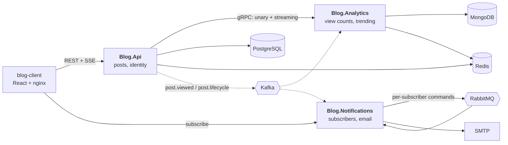

# Blog

A distributed blog platform: **React 19 + TypeScript** frontend, three **ASP.NET Core 8**
services, **Kafka** and **RabbitMQ**, **gRPC**, and **PostgreSQL / MongoDB / Redis**.

It began as a single API with a background worker. Each service, broker and datastore below was
added to solve a problem the previous shape actually had; where a familiar component was *not*
added, [`docs/adr/`](docs/adr/) records why.



| Service | Owns | Talks to |
|---|---|---|
| `Blog.Api` | posts, identity | PostgreSQL, Redis; Kafka producer; gRPC client |
| `Blog.Analytics` | view counts, trending | MongoDB, Redis; two Kafka consumer groups; gRPC server |
| `Blog.Notifications` | subscribers, delivery ledger | its own PostgreSQL database; Kafka in, RabbitMQ out, SMTP |

## The three decisions that shape it

**Kafka for facts, RabbitMQ for tasks.** `post.viewed` is high volume, append-only, and read by
two independent consumer groups at their own offsets — one writing every view to MongoDB, one
maintaining a rolling leaderboard in Redis sorted sets. A queue cannot do that: whichever
consumer got a message would have taken it from the other. Kafka also replays, so a metric added
next month can be backfilled from the retained log.

Email is the opposite. Each message is addressed to one person, fails on its own, needs retry
with backoff and a dead-letter queue — and must *never* be replayed en masse.
`Blog.Notifications` consumes one Kafka fact and produces N RabbitMQ commands, which is the
translation neither broker does for you.
([ADR-002](docs/adr/002-kafka-for-facts-rabbitmq-for-tasks.md))

**A transactional outbox for anything that must not be lost.** There is no transaction spanning
PostgreSQL and Kafka, so publishing a post writes the event as a row in the same transaction and
a relay ships it afterwards with `FOR UPDATE SKIP LOCKED`. Views deliberately skip the outbox and
go straight to Kafka — a view is a measurement, and making every page render write a row to
protect a counter is the wrong trade. Guarantees are chosen per event class, not applied
uniformly. ([ADR-004](docs/adr/004-transactional-outbox.md))

**gRPC for the internal read.** Every post render needs a view count: internal, synchronous,
high frequency. Protobuf over HTTP/2 on a reused connection, a contract the compiler checks on
both sides, a batch method so a listing costs one call rather than twenty — and server
streaming, which is what feeds the live trending panel.
([ADR-003](docs/adr/003-grpc-for-internal-reads.md))

### Delivery guarantees

| Event | Path | Why |
|---|---|---|
| `post.viewed` | straight to Kafka, fire-and-forget | A measurement. Nothing downstream is authoritative on it. |
| `post.published` | transactional outbox | Losing it means a post nobody was told about. |
| per-subscriber email | RabbitMQ, 5s → 30s → 5m ladder, then DLQ | Each is a task that fails on its own, is retried, then parked. |

Delivery is **at-least-once** end to end, not exactly-once. Consumers deduplicate on `EventId`
rather than pretending otherwise: the raw-view writer has a unique index on it, and the
notification relay one on `(event_id, subscriber_id)`. Replaying the whole lifecycle topic
produced 8 emails before and 8 after.

## Failure behaviour

A slow dependency degrades; it does not cascade. The gRPC client carries a 150 ms deadline, one
retry, and a circuit breaker, and every failure path returns "no counts" rather than an error.
Measured with the analytics service stopped: calls cost ~350 ms while the breaker samples, then
**24 ms** once it opens — and posts keep rendering throughout.

## Performance

Measured on 200k seeded posts, PostgreSQL 16:

| | before | after |
|---|---|---|
| Search, term with no matches | 3,960 ms (sequential scan) | **0.1 ms** (GIN index) |
| Search, term matching 25k rows | 2 ms, unranked | **3 ms**, relevance-ranked |
| Paging to row 150,000 | 14.6 ms (`OFFSET`) | **0.12 ms** (keyset) |

The naive `tsvector` + `ORDER BY ts_rank` was *slower* than the original scan for broad terms
(89 ms). The GIN lookup was only 3 ms — ranking was reading 22k heap blocks to score every
match. Bounding it to a 500-row candidate window made it flat regardless of match count.

## Observability

All three services export traces, metrics and logs over OTLP to a single
[Aspire dashboard](http://localhost:18888) container.

The part worth looking at is propagation across the async hops. HTTP gets it free; a broker does
not, so the producer writes the W3C `traceparent` into Kafka headers and the consumer reads it
back. The outbox adds a second gap — the originating request is long finished — so the
traceparent is stored *on the row* and restored at publish time.

Verified: the outbox row recorded `00-7dc87e3294aa1f2029554aa090415b4e-…`, and the notifications
service — a different process, reached via PostgreSQL and then Kafka — logged trace id
`7dc87e3294aa1f2029554aa090415b4e`.

`/health/live` deliberately checks nothing external: a liveness probe that touched the database
would turn a database blip into a cluster-wide restart storm. `/health/ready` checks
dependencies, so failing it drains an instance without killing it.

## Layout

```
src/posts/Blog.Posts.Domain/          Entities, value objects, domain events. No dependencies.
src/posts/Blog.Posts.Application/     Use cases and ports. No EF Core, no ASP.NET.
src/posts/Blog.Posts.Infrastructure/  EF Core, Redis, Kafka, search, the gRPC client
src/posts/Blog.Api/                   Controllers and DI wiring only
src/analytics/                        gRPC server + two Kafka consumer groups
src/notifications/                    Kafka relay, RabbitMQ worker, SMTP, subscriptions API
src/shared/Blog.Contracts/            Integration events. No dependencies, shared by everything.
src/shared/Blog.Contracts.Grpc/       The generated gRPC contract, built once from the .proto
src/shared/Blog.Observability/        OpenTelemetry, Kafka trace propagation, health probes
src/blog-client/                      React + Vite SPA
tests/                                Unit (xUnit + Moq), API, and Testcontainers integration
deploy/compose/                       Local and production Docker Compose stacks
deploy/k8s/                           Kustomize base + dev/prod overlays
docs/adr/                             Architecture Decision Records
```

The posts service gets full four-layer separation; the two workers get two or three projects
each. That asymmetry is deliberate — layering a small worker as heavily as the core service is
ceremony. The dependency rule is enforced by
[architecture tests](tests/Blog.Posts.UnitTests/ArchitectureTests.cs), not by convention: the
domain must reference nothing but the BCL, and the application layer must not reference EF Core,
Npgsql, MongoDB, RabbitMQ, Redis or ASP.NET.

## Run it

```bash
docker compose -f deploy/compose/docker-compose.yml up -d --build
```

| | |
|---|---|
| Site | <http://localhost:8080> — sign in `admin@localhost.dev` / `AdminDev04!` |
| Traces, metrics, logs | <http://localhost:18888> |
| Kafka topics and consumer lag | <http://localhost:8081> |
| RabbitMQ — the retry ladder and DLQ | <http://localhost:15672> (`blog` / `blogpass`) |
| Every email the stack sends | <http://localhost:8025> |
| Health | `:5028` api, `:5029` analytics, `:5030` notifications — `/health/ready` |

Watch the live trending stream directly:

```bash
curl -N http://localhost:8080/api/analytics/trending/stream
```

## Kubernetes

```bash
kubectl apply -k deploy/k8s/overlays/dev
```

Kustomize rather than Helm — no templating language to debug, built into `kubectl`, and overlays
express "dev differs from prod in these four ways" more directly than a values file that has to
anticipate every difference.

The `dev` overlay runs dependencies in-cluster so an empty cluster comes up working. The `prod`
overlay omits them entirely, expects managed services, and contains **no Secret** —
`blog-secrets` is created out of band by External Secrets, Sealed Secrets or a cloud CSI driver.

Autoscaling differs by workload, on purpose. The API scales on CPU. The consumers scale on
**Kafka consumer lag** and **RabbitMQ queue depth** via KEDA, because CPU is the wrong signal for
a consumer: a million-event backlog looks exactly like an idle pod when the bottleneck is
MongoDB rather than the CPU.

`deploy/k8s/validate.py` checks what `kustomize build` cannot — probes pointing at undeclared
ports, Services selecting nothing, autoscalers targeting a renamed Deployment, a `ScaledObject`
fighting a static replica count. It runs in CI.

## Develop

```bash
dotnet build
dotnet test          # integration tests need Docker; the rest do not

cd src/blog-client && npm ci && npm run dev
```

The API falls back to SQLite when PostgreSQL is configured but unreachable, so
`dotnet run --project src/posts/Blog.Api` works with nothing else running.

### Migrations

Always scaffolded against PostgreSQL; SQLite creates its schema from the model.

```bash
dotnet ef migrations add <Name> \
  --project src/posts/Blog.Posts.Infrastructure \
  --startup-project src/posts/Blog.Api
```

## CI

Builds and tests everything, then rebuilds only the images whose service actually changed — a
change to shared contracts rebuilds all of them, a change to one service's own code does not.
Images are scanned with Trivy and the results uploaded to the security tab; a base-image CVE
with no fix available should be visible, not a reason the pipeline cannot ship.
