# Blog

This project is a distributed blog platform. It is split into three ASP.NET Core
services that own separate databases and talk over Kafka, RabbitMQ and gRPC. The
frontend is React 19 + TypeScript, served by nginx.

<picture>
  <source media="(prefers-color-scheme: dark)" srcset="docs/architecture-dark.svg">
  
</picture>

`Blog.Api` owns posts, identity, PostgreSQL and Redis.

`Blog.Analytics` owns view counts, trending, MongoDB and Redis.

`Blog.Notifications` owns subscribers, the delivery ledger and its own
PostgreSQL database.

## How it works

**Kafka.** Two topics:

```
blog.post.viewed.v1      6 partitions, 7 day retention
blog.post.lifecycle.v1   3 partitions, 30 day retention
```

The producer runs with `acks=all` and idempotence on. Every message carries
`event-type`, `schema-version` and `traceparent` headers. Three consumer groups
read those topics. `analytics-raw-writer` and `analytics-trending` both read
`blog.post.viewed.v1` at their own offsets, so each one receives every message.
`notifications-relay` reads `blog.post.lifecycle.v1`.

**The outbox.** No transaction spans PostgreSQL and Kafka, so publishing a post
writes the event as a row in the same transaction as the post. A relay polls
every 2 seconds, claims up to 100 rows, publishes them and marks them sent. A row
that fails 10 times stops being retried and stays in the table.

`post.viewed` skips the outbox and goes straight to the producer.

**RabbitMQ.** Three exchanges and five queues:

```
blog.notifications         direct   → blog.notifications.email
blog.notifications.retry   direct   → retry.5s, retry.30s, retry.5m
blog.notifications.dlq     fanout   → blog.notifications.dlq
```

The retry queues have no consumer. Each carries an `x-message-ttl` of 5000,
30000 or 300000 ms and dead-letters back to the main exchange when it expires, so
a failed message reappears on the email queue after the delay. After 4 attempts
it is routed to the fanout.

Delivery is at-least-once. A unique index on `EventId` in MongoDB and on
`(event_id, subscriber_id)` in the ledger absorbs the duplicates. Replaying the
whole lifecycle topic produced 8 emails before and 8 after.

**gRPC.** Four RPCs on port 8080, bound as HTTP/2. Port 8081 is HTTP/1 for the
health probes. Three RPCs are unary. `StreamTrending` is a server stream that the
API bridges to Server-Sent Events because a browser cannot consume gRPC. The
client carries a 150 ms deadline.

## Features

- Transactional outbox, so a committed post is always published
- Two Kafka consumer groups on one topic, reading at independent offsets
- RabbitMQ retry ladder at 5s, 30s and 5m, then a dead letter queue
- gRPC unary, batch and server streaming, bridged to SSE for the browser
- Tracing with the `traceparent` stored on the outbox row
- Full-text search on a GIN index with weighted ranking, and keyset paging
- Unit, API and Testcontainers integration tests

## Configuration

`appsettings.json`. An empty value disables the thing it configures
instead of failing the boot:

```
ConnectionStrings:Redis   Empty disables caching and trending.
Kafka:BootstrapServers    Empty stops the relay and all three consumer groups.
Analytics:Address         http://host:port of the analytics gRPC service.
Otlp:Endpoint             Empty disables telemetry export.
Database:Provider         Postgres or Sqlite.
Jwt:Key                   At least 32 bytes, checked at startup.
```

## Tests

74 tests run without Docker. The integration suite starts real PostgreSQL, Kafka,
MongoDB and Redis with Testcontainers and needs it.

## Usage

### Dependencies

.NET 8 SDK, Node 22, Docker and Docker Compose. The brokers and databases all
come from the compose stack.

### Run

```bash
docker compose -f deploy/compose/docker-compose.yml up -d --build
```

This will build the four images, start PostgreSQL, Redis, MongoDB, Kafka and
RabbitMQ, create the Kafka topics, apply the migrations and seed an admin user.

- Site: <http://localhost:8080>, sign in `admin@localhost.dev` / `AdminDev04!`
- Traces, metrics and logs: <http://localhost:18888>
- Kafka topics and consumer lag: <http://localhost:8081>
- RabbitMQ, the retry ladder and the DLQ: <http://localhost:15672>, `blog` /
  `blogpass`
- Every email the stack sends: <http://localhost:8025>
- Health: `:5028` api, `:5029` analytics, `:5030` notifications, `/health/ready`

The trending stream, directly:

```bash
curl -N http://localhost:8080/api/analytics/trending/stream
```

## CI

Builds and tests everything, then rebuilds only the images whose service changed.